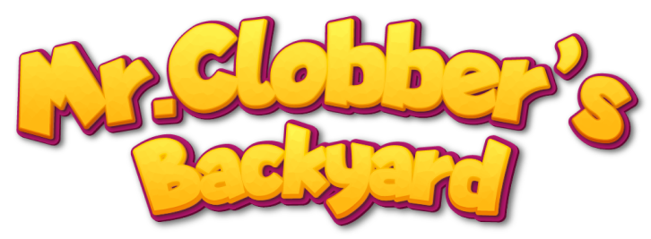

# Mr. Clobber's Backyard



> **Course project** — Fundamentals of Programming, Ferdowsi University of Mashhad, Fall 2023

A 4-player, turn-based strategy game written in C with the
[Allegro](https://liballeg.org/) game library. Each player controls a cat
navigating a walled 15×15 maze, competing to collect the most points before
the round limit by catching mice, dodging roaming dogs, and using items
scattered across the board.

Highlights of the final release: a full graphics pass, main menu + pause
menu, fullscreen support, save/load of game state, and background music.

## Gameplay

- **Turn order** is redrawn every round with a dice roll (`Dice.h`): each of
  the 4 cats rolls a die, ties are re-rolled until every player has a unique
  rank, and that order becomes the turn sequence.
- **Movement** is grid-based (arrow keys / WASD to move the active cat,
  Space/Enter to end your turn), constrained by walls and up to 4 objects per
  cell (`isLegal`, `move` in `logics.h`).
- **Mice** come in three tiers (1, 2, or 3 points) — catching one adds its
  value to your score and sends it back to its spawn point.
- **Candy** boosts a cat's attack stat; **fish** restore defense.
- **Traps** are hidden until triggered; stepping on one forces the cat to
  drop (free) all mice it's currently holding.
- **Combat**: when a cat shares a cell with another cat or a dog, `fight()`
  resolves the outcome by comparing `attack × defense`. The loser is stunned
  for several rounds and forfeits its collected mice to the winner (or, for
  a lost cat/dog fight, has to release them back onto the board).
- **Dogs** (bulldog, pitbull, shepherd, bulldog Jr.) move randomly each round
  at their own speed and are dangerous to run into.
- The game ends after a fixed number of rounds; cats are ranked by score, the
  results are shown on an end screen, and also written out to `result.txt`.
- Progress can be saved and continued from the main menu (`Continue` /
  `New Game` / `Quit`).

## Tech stack

- C
- [Allegro 5](https://liballeg.org/) (`allegro5`, `allegro_ttf`,
  `allegro_primitives`, `allegro_image`) for windowing, input, and rendering
- Visual Studio (project + solution files, Allegro pulled in via NuGet —
  see `Source Code/packages.config`)

## Running it

1. Open `Source Code/Mrclobbersbackyard.sln` in Visual Studio.
2. Restore NuGet packages (Allegro 5.2.9 + AllegroDeps) — Visual Studio does
   this automatically on build if NuGet package restore is enabled.
3. Build and run (x86/x64, Debug or Release).

## Project structure

```
Designs/                — source art (.ai/.psd) and exported sprites
Source Code/
    main.c                — entry point: spawns cats, dogs, mice, items, starts the game
    MainMenu.h              — main menu (Continue / New Game / Quit)
    LoadGame.h, SaveGame.h    — save-file handling
    gameinit.h, init.h, initialize.h — Allegro setup, asset loading
    map.h                      — board state, wall generation, spawning
    types.h                     — shared structs (obj, stats) and global board arrays
    logics.h                     — movement, collision, combat, turn/round logic
    Dice.h                        — per-round turn-order dice roll
    Graphics.h                     — rendering
    Pause.h, GameOver.h              — pause screen, end-of-game scoring/results
    Assets/                            — sprites, fonts, music used at runtime
```

## Team

Built as a 2-person team project:

- Sadra Alikhah — [@sadraalikhah](https://github.com/sadraalikhah)
- Reza Farasati — [@Rfarasati](https://github.com/Rfarasati)

## Known limitations

- `Source Code/Assets/SaveState.dat` (a runtime save file) is currently
  committed to the repo and should be removed from version control.
- `Source Code/main.exe` is kept in the repo intentionally, as a prebuilt
  binary so the game can be played without building from source.
